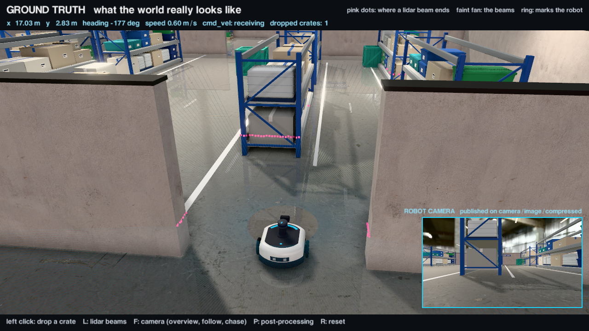
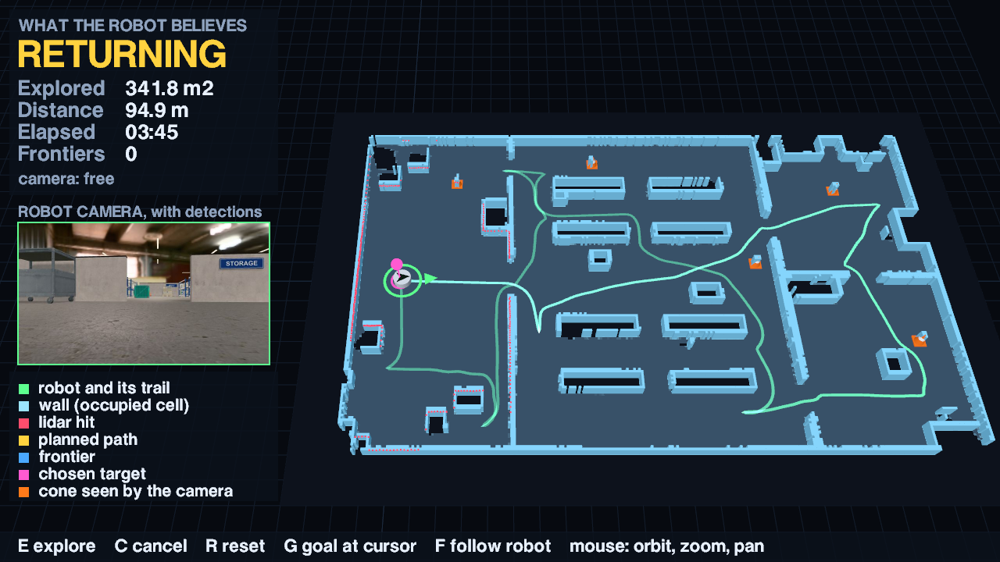
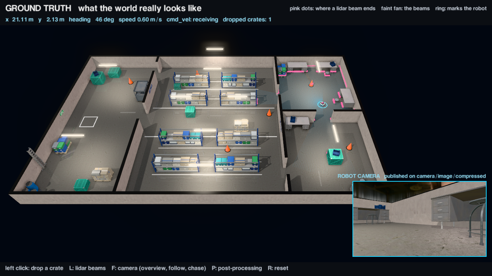
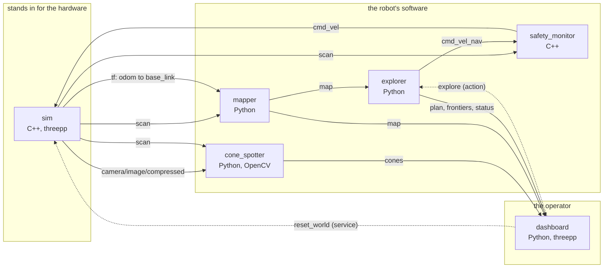

# A robot explores a warehouse: ROS 2 in C++ and Python, with threepp



A small robot is switched on in a warehouse it has never seen. It has a lidar, a camera
and two wheels. Nobody drives it. Four or five minutes later it has driven through every
aisle, drawn a map of the building, found the traffic cones standing around in it
(usually all six), and parked where it started.

Everything you see is a ROS 2 graph of six nodes, two written in C++ and four in Python,
and both languages draw their picture with [threepp](https://github.com/markaren/threepp):

* the **simulator** (C++) is the world as it really is, and stands in for the robot's hardware
* the **dashboard** (Python) is the world as the robot believes it to be



A whole run, twelve times faster than life: [docs/media/run.mp4](docs/media/run.mp4)
(simulator on the left, dashboard on the right).

This is the demo for Part 7 of the AIS2203 book ("Robot Middleware: ROS2"). It is also
where the earlier parts meet: the threads and mailboxes of Part 2, the futures of Part 3,
the "typed pub/sub" of Part 4, the CMake and Python interop of Part 5, the OpenCV of
Part 6. [Where to find what](#where-to-find-what) says in which file.

## Run it

You need Windows 10 or 11, [pixi](https://pixi.sh), git, and Visual Studio 2022 with the
"Desktop development with C++" workload (the same compiler the course already uses).

```powershell
git clone <this repository>
cd threepp_ros2_demo
pixi install -e jazzy        # ROS 2 Jazzy, the build tools, threepp for Python (about 4 GB, once)
pixi run -e jazzy build      # compiles the seven packages (about 4 minutes the first time)
pixi run -e jazzy demo       # starts everything
```

Two windows open and the robot starts exploring on its own.

`pixi.toml` is the course's RoboStack file with a few lines added, and the environment
has the same name, so everything the book says about `pixi shell -e jazzy` applies here
unchanged. The environment lives in `.pixi/` inside this folder: nothing is installed
system-wide, and deleting the folder removes all of it.

The first build is slow because it compiles threepp itself (about 2.5 minutes). After
that, a change to one package takes seconds:

```powershell
pixi run -e jazzy build --packages-select explorer_sim
```

### Other ways to start it

```powershell
# No exploring until you press E in the dashboard
pixi run -e jazzy ros2 launch explorer_bringup demo.launch.py auto_explore:=false

# With RViz next to it, to see the same topics in the standard tool
pixi run -e jazzy ros2 launch explorer_bringup demo.launch.py rviz:=true

# Only the robot and its safety reflex. Drive it yourself from a second terminal:
pixi run -e jazzy ros2 launch explorer_bringup sim.launch.py
pixi run -e jazzy ros2 run teleop_twist_keyboard teleop_twist_keyboard --ros-args -r cmd_vel:=cmd_vel_nav

# On a laptop without a real graphics card: no ambient occlusion, bloom or reflections
pixi run -e jazzy ros2 launch explorer_bringup demo.launch.py effects:=false
```

`ros2 launch explorer_bringup demo.launch.py --show-args` lists every argument.

```powershell
pixi run -e jazzy test       # the unit tests of the mapping, planning and vision code (no ROS needed)
```

## The two windows

**The simulator: ground truth.** What a camera on the ceiling would see.



| Input | Effect |
|---|---|
| left click on the floor | drop a crate there. Try it right in front of the robot |
| `F` | camera: overview, follow the robot, chase (ride behind it) |
| `L` | show or hide the lidar beams |
| `P` | post-processing on or off (ambient occlusion, bloom, floor reflections) |
| `R` | robot back to the start, dropped crates removed |
| mouse drag, wheel | orbit and zoom |

The inset in the corner is what the robot's own camera sees. The same picture goes out
on the topic `camera/image/compressed`.

**The dashboard: belief.** Only what has arrived over ROS topics: the map as far as the
lidar has seen it, the planned path, the frontiers (the edges of the known world), the
cones the camera has confirmed.

| Input | Effect |
|---|---|
| `E` | start exploring (sends a goal to the `explore` action) |
| `C` | cancel it |
| `G` | send the robot to the point under the mouse cursor |
| `R` | reset the simulator and clear the map |
| `F` | follow the robot |

Put the windows side by side. Where they disagree, the robot is wrong and does not know
it yet. That gap is what robotics is about.

## The graph



While it runs, draw the real thing with `pixi run -e jazzy rqt_graph`, and look at any
arrow with `ros2 topic echo`, `ros2 topic hz` or `ros2 topic bw`.

Every name, type, rate and QoS setting is written down in
[docs/interfaces.md](docs/interfaces.md). That page is the only thing the six programs
have in common. Three of them were written without sight of the others, against that
page alone, and worked together on the first run.

| Package | Language | What it is |
|---|---|---|
| [`explorer_interfaces`](src/explorer_interfaces) | `.msg` `.srv` `.action` | The custom message, service and action |
| [`explorer_sim`](src/explorer_sim) | C++, threepp | The world, the robot, its lidar and camera |
| [`explorer_safety`](src/explorer_safety) | C++ | The reflex between the planner and the motors. The smallest complete node: start reading here |
| [`explorer_nav`](src/explorer_nav) | Python, numpy | Mapping, frontier exploration, path planning, path following |
| [`explorer_vision`](src/explorer_vision) | Python, OpenCV | Finds the cones in the image, places them on the map with the lidar |
| [`explorer_dashboard`](src/explorer_dashboard) | Python, threepp | The operator's 3D view and buttons |
| [`explorer_bringup`](src/explorer_bringup) | launch, YAML | Starts it all, holds the parameters |

## Where to find what

### ROS 2 concepts

| Concept | The clearest example of it here |
|---|---|
| Node, publisher, subscriber | [`safety_monitor.cpp`](src/explorer_safety/src/safety_monitor.cpp): 160 lines, all of it |
| The same in Python | [`mapper_node.py`](src/explorer_nav/explorer_nav/mapper_node.py) |
| QoS: sensor data vs reliable vs "latched" | [`sim_node.cpp`](src/explorer_sim/src/sim_node.cpp) (publishers), `safety_monitor.cpp` (`safety_stop`), the table in [interfaces.md](docs/interfaces.md) |
| Custom message, service, action | [`explorer_interfaces`](src/explorer_interfaces): three small files, each explains itself |
| Service server and client | `sim_node.cpp` (`spawn_obstacle`), [`dashboard_node.py`](src/explorer_dashboard/explorer_dashboard/dashboard_node.py) (`reset_world`) |
| Action server (goal, feedback, result, cancel) | [`explorer_node.py`](src/explorer_nav/explorer_nav/explorer_node.py) |
| Action client | `dashboard_node.py` |
| Parameters, and changing one while the node runs | `sim_node.cpp` (`lidar_noise`), [`explorer.yaml`](src/explorer_bringup/config/explorer.yaml) |
| tf2: publishing frames | `sim_node.cpp` (`odom -> base_link`, the sensor mounts) |
| tf2: asking "where was the robot at time t?" | `mapper_node.py`, [`cone_spotter_node.py`](src/explorer_vision/explorer_vision/cone_spotter_node.py) |
| Time stamps that mean "when it was measured" | [`window.cpp`](src/explorer_sim/src/window.cpp) (one stamp for scan and image), `cone_spotter_node.py` (pairing by stamp) |
| Executors and callback groups | `explorer_node.py` (multi-threaded), `safety_monitor.cpp` (why it locks anyway) |
| Launch files, arguments, including one in another | [`demo.launch.py`](src/explorer_bringup/launch/demo.launch.py), [`sim.launch.py`](src/explorer_bringup/launch/sim.launch.py) |
| Remapping a topic | the teleop command above |
| A package that only installs files | [`explorer_bringup`](src/explorer_bringup/CMakeLists.txt) |
| Installing data files and finding them at run time | `explorer_sim/CMakeLists.txt`, `sim_node.cpp` (the ament index) |

### The rest of the book

| Part | Where it shows up |
|---|---|
| 1. Smart pointers, lambdas, `std::chrono` | Everywhere in `explorer_sim`. `shared_ptr<const CameraFrame>` in [`types.hpp`](src/explorer_sim/include/explorer_sim/types.hpp) hands a 690 kB picture between threads by copying a pointer |
| 2. Threads, shared data, mailbox and queue | [`main.cpp`](src/explorer_sim/src/main.cpp) of the simulator: three threads, four shared objects, no other mutex. `Mailbox` and `ThreadSafeQueue` are the book's classes, unchanged |
| 3. Futures and promises, fixed timestep, rolling deadlines | `Simulator::requestSpawn` in [`simulator.cpp`](src/explorer_sim/src/simulator.cpp): a service callback posts a job to the render thread and waits on a future. The fixed-timestep loop and `sleep_until` are in [`window.cpp`](src/explorer_sim/src/window.cpp) |
| 4. Typed pub/sub, schemas, QoS, streaming JPEG | `docs/interfaces.md`, `explorer_interfaces`, the camera publisher in `sim_node.cpp` |
| 5. CMake targets, dependencies, "one owner per library", C++ from Python | `explorer_sim/CMakeLists.txt` (FetchContent, and a library that cannot include ROS by construction). The dashboard drives the same C++ engine through its Python bindings |
| 6. OpenCV, simulated sensors, the camera as a sensor | [`cone_detector.py`](src/explorer_vision/explorer_vision/cone_detector.py), `castLidar()` and `captureCamera()` in `simulator.cpp` |
| The Pimpl idiom | [`simulator.hpp`](src/explorer_sim/include/explorer_sim/simulator.hpp) keeps threepp out of the ROS node's translation unit |

[docs/architecture.md](docs/architecture.md) explains how the pieces work and why they
are built the way they are.

## Things to try

Start the demo, open a second terminal in this folder, and enter the environment with
`pixi shell -e jazzy`.

1. **Drop a crate in the robot's path** (left click in the simulator). The lidar sees
   it, the safety monitor brakes, the map gains an obstacle, the planner goes around.
   Which of those happens first? Watch `ros2 topic echo /safety_stop`.
2. **Make the lidar worse while it runs.**
   `ros2 param set /sim lidar_noise 0.08`. The walls in the dashboard grow fuzzy. Now
   `0.3`. At what point does exploration stop finishing, and why?
3. **Let the odometry lie.** Restart, then `ros2 param set /sim odom_drift 1.0`. The map
   starts to smear and the robot ends up "inside" walls in the dashboard while it is
   fine in the simulator. Plot the error:
   `ros2 topic echo /odom --field pose.pose.position` against `/ground_truth`. This is
   the problem that SLAM solves, and why `map -> odom` exists as a separate transform.
4. **Kill the brain.** Stop the `explorer` process in Task Manager mid-drive. The robot
   stops within half a second. Find the two places in the code that guarantee it
   (hint: one is in the simulator, one would be in any real motor driver).
5. **Blind the reflex.** `ros2 topic pub /scan sensor_msgs/msg/LaserScan` with nothing
   useful in it does not fool it. Stopping the simulator's scan does: what does the
   safety monitor do without scans, and why is that the right default?
6. **Measure the camera.** `ros2 topic hz /camera/image/compressed`, then `ros2 topic bw`.
   Work out what the raw image would cost per second and compare.
7. **Watch the detector work.** The dashboard's camera panel shows the picture with a
   box around every cone the detector finds. Now loosen it:
   `ros2 param set /cone_spotter saturation_min 30`, and see what else is "orange".
   (The same picture is the topic `/camera/annotated/compressed`, for `rqt_image_view`.)
8. **Break the QoS on purpose.** In `safety_monitor.cpp`, subscribe to `scan` with a
   plain `10` instead of `SensorDataQoS()`. Rebuild, run. No error, no data. Find out
   why with `ros2 topic info /scan --verbose`.
9. **Take the wheel.** Start with `auto_explore:=false`, press `G` in the dashboard to
   send the robot somewhere. Then do the same from RViz with "2D Goal Pose". Two
   programs, one topic.
10. **Send the goal yourself.**
    `ros2 action send_goal /explore explorer_interfaces/action/Explore "{time_limit: 60.0, return_home: true}" --feedback`

[docs/exercises.md](docs/exercises.md) has larger tasks, from "add a battery topic" to
"two robots".

## When it does not work

| Symptom | Cause and cure |
|---|---|
| `VisualStudioVersion is not set` | You ran `colcon build` directly. Use `pixi run -e jazzy build`, which loads the compiler first |
| Nodes start, topics are listed, but no data flows | The DDS implementation. This project sets `RMW_IMPLEMENTATION=rmw_cyclonedds_cpp` in `pixi.toml`. If you set the variable yourself somewhere else, or mix terminals with different settings, nodes can see each other and still not talk |
| `Package 'explorer_bringup' not found` | The workspace is not sourced in this terminal. Leave the shell and enter it again with `pixi shell -e jazzy` (it sources `install/` on entry), or use `pixi run -e jazzy ...` |
| The first `pixi run` prints "Could not find activation scripts" | Harmless before the first build: `install/` does not exist yet |
| Windows asks about the firewall | DDS finds other nodes over the network. Allow it for private networks |
| Everyone in the room sees everyone else's robot | You share a network and a ROS domain. Give each machine its own: `$env:ROS_DOMAIN_ID = "17"` (0 to 101) before starting |
| The simulator is slow | `effects:=false`, and a smaller window: `ros2 launch explorer_bringup demo.launch.py effects:=false` |
| `ros2 topic list` hangs or shows stale topics | The ROS daemon is confused. `ros2 daemon stop`, then try again |

## What this is not

It is a teaching demo, and it cuts the corners that would hide the ideas:

* **No SLAM.** The robot trusts its odometry, which the simulator makes perfect by
  default. Exercise 3 above shows what that hides.
* **No physics engine.** The robot is a disc that cannot enter boxes. Enough for a lidar
  and a map, and it keeps the simulator's only dependency threepp.
* **Nobody plans for the camera.** The explorer goes where the lidar has not seen yet.
  The lidar sees all around and 8 m far, the camera 80 degrees ahead and 5 m, so a cone
  the robot happens never to face is never found. In four recorded runs it found
  6, 6, 6 and 5 of the six. Fixing that is one of the [exercises](docs/exercises.md).
* **The cone detector is a colour threshold**, not a neural network. The interface is
  the one the book uses (`vision_msgs/Detection2DArray`), so swapping in the ONNX
  detector from Part 6 changes one Python module.
* **Windows only**, as tested. Nothing in the code is Windows-specific except one
  function in the dashboard (the mouse position for `G`), but `pixi.toml` lists only
  `win-64` and `build.bat` is a batch file.

## Credits

* [threepp](https://github.com/markaren/threepp), the C++ port of three.js, in C++ (fetched
  by CMake at tag `2026-10-11`) and in Python (`pip install threepp`, the same release).
* ROS 2 Jazzy through [RoboStack](https://robostack.github.io/) and [pixi](https://pixi.sh).
* Textures, the HDRI and some props from [Poly Haven](https://polyhaven.com), CC0. The
  racks, pallets, crate, signs and the robot were modelled with Blender scripts in
  [`tools/blender`](tools/blender). Details in
  [`src/explorer_sim/assets`](src/explorer_sim/assets/README.md).

MIT licence, see [LICENSE](LICENSE).
