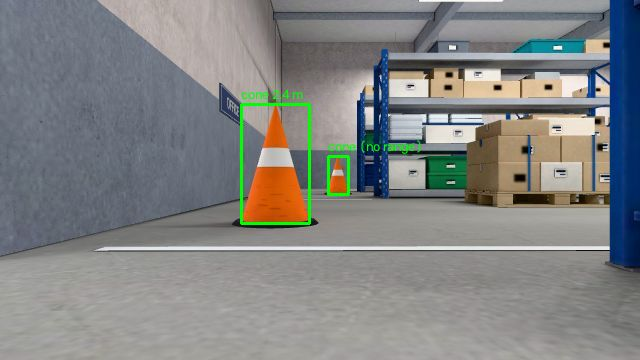

# How it works, and why it is built this way

The [README](../README.md) shows what the demo does. [interfaces.md](interfaces.md) lists
every topic. This page explains the insides: one section per node, then the decisions
that shaped the whole.

## The loop

Every robot runs the same loop, and each part of it is one node here:

```
        sense                 model                  decide                 act
   lidar, camera  ------>  a map, cones  ------>  where next,  ------>  wheel speeds
       (sim)             (mapper, spotter)       which path             (explorer,
         ^                                        (explorer)             safety)
         |                                                                  |
         +------------------------ the world changes -----------------------+
```

The simulator closes the loop. Replace it with drivers for a real lidar, a real camera
and real motors that publish and subscribe the same topics, and nothing else changes.
That is the point of putting a simulator *behind ROS topics* rather than calling it
directly: the software under test cannot tell the difference.

## `sim`: the world, in C++

[`src/explorer_sim`](../src/explorer_sim)

### Two halves that cannot see each other

| File | Includes threepp | Includes ROS | Job |
|---|---|---|---|
| `simulator.cpp` | yes | no | what happens: physics, lidar, camera |
| `scene.cpp` | yes | no | what is drawn: materials, models, lights |
| `window.cpp` | yes | no | the window and the frame loop |
| `world.cpp` | no | no | the building as a list of boxes, collision |
| `sim_node.cpp` | no | yes | topics, services, parameters |
| `types.hpp`, `mailbox.hpp`, `thread_safe_queue.hpp` | no | no | what the two halves share |
| `main.cpp` | no | yes | creates both, starts the threads |

This is enforced, not just intended. The simulator half is its own CMake library that
does not link `rclcpp`, so a ROS include in it fails to compile. And `simulator.hpp`
hides threepp behind the Pimpl idiom, so the ROS half never sees a threepp header. You
could put the simulator behind MQTT or a raw socket (Part 4 of the book) by replacing
one file.

### Three threads, and the few places where they meet

```
 executor thread                       main thread                      publisher thread
 (rclcpp::spin)                        (render loop)                    (queue consumer)
 --------------                        -------------                    ----------------
 cmd_vel callback  --Mailbox<VelocityCommand>-->  physics
 parameter change  --Mailbox<Tuning>----------->  sensors
 camera timer      <--Mailbox<CameraFramePtr>---  camera render
 service callback  --job + std::promise-------->  runs the job, fulfils the promise
                                                  sensor tick  --ThreadSafeQueue<Telemetry>-->  publish tf, odom, scan
```

* The **main thread** owns the window. OpenGL is thread-affine: only the thread that
  created the context may draw or read pixels back. So rendering, the camera sensor and
  (for simplicity) the physics and the lidar all live there.
* The **executor thread** runs every ROS callback. `canvas.animate()` does not return
  until the window closes and `rclcpp::spin()` does not return until ROS shuts down, so
  one of them has to move. The book's answer is used: `std::jthread executor([node] { rclcpp::spin(node); })`.
* The **publisher thread** takes sensor ticks off a queue and publishes them, so the
  render loop never waits for the middleware.

That drawing is the complete list: three mailboxes, the telemetry queue, the job
queue with its promises, and one atomic flag that asks the render loop to stop. Nothing
else is touched by more than one thread, and no code outside those objects needs a lock.

A mailbox where only the newest value matters (a velocity command, a camera frame). A
queue where every item counts (each sensor tick becomes a tf sample). Both classes are
the book's, unchanged apart from a `tryPop()`.

### A service call that has to cross threads

`spawn_obstacle` must add a mesh to the scene. The callback runs on the executor
thread, the scene belongs to the main thread. So the callback does not touch the scene.
It posts a job and gets a `std::future` back:

```
executor thread:  future = simulator.requestSpawn(x, y, size);   // pushes a job + promise
                  future.wait_for(2s); result = future.get();    // normally back within one frame
main thread:      while (auto job = jobs.tryPop()) (*job)();     // runs it, sets the promise
```

The wait is bounded on purpose. If the render loop is busy (Windows stalls it while a
window is being dragged), the callback gives up after two seconds. If the simulator
shuts down with jobs still queued, it destroys them: that breaks their promises,
`future.get()` throws `std::future_error`, and the waiting callback answers "the
simulator did not answer" instead of hanging forever. A job that throws passes its
exception through the promise in the same way.

### Physics, and sensors at their own rate

The render callback measures how much wall-clock time has passed and steps the physics
in fixed 1/240 s increments until it has caught up (the accumulator pattern from the
book's chapter on virtual environments). The "physics" is small on purpose: a
differential-drive robot with speed and acceleration limits, as a disc that cannot
enter boxes.

Sensors fire every 1/30 s (odometry) and every third tick of that (lidar and camera),
whatever the frame rate, as long as it is at least 30 frames a second. A sensor tick
happens inside a frame, so on a machine that draws slower than that, the sensors slow
down with it. The lidar and the camera fire on the same tick and carry the
**same time stamp**, like a hardware-synchronised sensor rig. `cone_spotter` relies on
it to pair an image with its scan.

* **Lidar.** One ray per beam into the scene with threepp's `Raycaster`, plus Gaussian
  noise. The rays are tested against simple shapes, not against the detailed models
  you see: every rack, crate or desk has a hidden box (its collision and lidar shape)
  and a visible model, and a cone is tested against a plain cone. All simulators do this.
* **Camera.** threepp's `CameraSensor` renders the scene from the robot's viewpoint
  into an off-screen target and reads the pixels back. The node converts them to JPEG
  on the executor thread and publishes them with their intrinsics (`CameraInfo`).
* **Odometry.** The true motion, or with `odom_drift` above zero a slightly wrong
  version of it that accumulates error.

A command older than half a second counts as "stop". A controller that crashes must not
leave the robot driving.

### What makes it look the way it does

While the simulator runs, all of it is the OpenGL renderer (`GLRenderer`): nothing needs
ray tracing. The ray tracing was done beforehand, once.

* **The light is baked.**
  [`tools/blender/make_warehouse.py`](../tools/blender/make_warehouse.py) builds the
  building in Blender at the measures of `world.cpp`, stands every prop where its box
  is, and lets Blender's path tracer (Cycles) work out how much light falls on every
  spot: straight from the lamps and windows, and after bouncing between floor, walls and
  ceiling. The result is a *lightmap* for each mesh, a picture of light. The simulator
  multiplies a surface's colour with it (`buildBakedBuilding()` in
  [`scene.cpp`](../src/explorer_sim/src/scene.cpp)). That is the cheapest material there
  is, cheaper than one real-time lamp, and it carries exactly what a real-time lamp
  cannot give: bounce light, and the soft shadow under a rack.
* **The props are baked with their colour.** A wall has a colour texture that repeats,
  so its lightmap only holds light. A carton has a label, tape, dust and a shadow side,
  different in every spot. So for the props Blender bakes colour times light into one
  picture per room, after giving every material blotches, speckle and worn edges.
* **What it costs: the light does not move.** A lightmap is right for as long as
  nothing moves. The building and its racks do not. The robot, the cones and a crate
  you drop do, so they are lit the ordinary way, by a few lamps and an HDRI (a 360
  degree photo of a real warehouse), and they cast no shadow into the baked light.
  A box you add to `world.cpp` is drawn that way too, until the bake has been run again.
* **Two ways to see the building.** The overview shows it cut open at door height, like
  an architect's section. The robot's camera and the chase view are inside and see the
  ceiling. `lookFrom()` shows or hides the upper part before each picture is drawn.
* **What the sensors hit is not what you see.** The lidar's rays and the collisions
  still use the plain boxes of `world.cpp`. The baked building is only looked at.
* an `EffectComposer` chain on top: ambient occlusion (`GTAOPass`) and bloom
  (`UnrealBloomPass`)
* a `Reflector` blended over the floor with a Fresnel term, for the polished-concrete
  look: the windows mirror in it
* a 2D layer on top (`hud.cpp`, laid out in `overlay.cpp`): cards are rounded `Shape`s,
  letters are triangles made from the system font's outlines, so the text is sharp at
  any size. The dashboard gets the same from threepp's ready-made `threepp.lesson.Hud`

A full bake takes five and a half minutes on a desktop graphics card and needs Blender
5. Nobody who only runs the demo needs it: the baked files are in the repository. If
they are missing, the simulator builds a plain model instead (low walls, real-time
lamps), which is also the shortest way to read how a scene is put together by hand.

## `safety_monitor`: the reflex, in C++

[`src/explorer_safety`](../src/explorer_safety)

It sits between the planner and the motors (`cmd_vel_nav` in, `cmd_vel` out) and looks
only at the strip of floor straight ahead of the robot, as wide as the robot plus a
margin. Forward speed is scaled from full at 0.5 m of clearance down to zero at 0.1 m.
Turning is never limited. With no scan for half a second it lets nothing through.

It is deliberately stupid, and separate. A reflex has to keep working when the clever
code is wrong, slow or dead.

## `mapper`: scans into a map, in Python

[`src/explorer_nav`](../src/explorer_nav), details in its [README](../src/explorer_nav/README.md)

An occupancy grid in log-odds. For each scan it asks tf2 where the laser was *at the
scan's time stamp*, then lowers the cells each beam passed through and raises the cell
where it ended. tf2 may not have that transform yet when the scan arrives, so scans
wait in a short queue until it does.

There is no localisation. The mapper publishes `map -> odom` as a fixed identity, which
is a way of saying "I trust the odometry completely". A SLAM system is the thing that
would move that transform.

One is a launch argument away: `mapper:=slam_toolbox` starts
[slam_toolbox](https://github.com/SteveMacenski/slam_toolbox) instead of this node. It
matches every scan against the map built so far, publishes `map -> odom` as the
correction that makes them agree, and straightens the whole map when the robot comes
back to a place it has seen (a loop closure). Same topics in, same topics out. What it
does not have is a file you can read in ten minutes, which is why this node exists.

## `explorer`: where to go and how, in Python

Same package.

* **Frontiers.** A frontier is a known-free cell next to an unknown one: the edge of the
  map. Exploring means driving to frontiers until there are none.
* **One distance field, two uses.** A wavefront from the robot over the traversable
  cells gives the path length to every reachable cell. That ranks the frontiers
  (nearest by path, not by straight line) and, followed downhill, is the path.
* **Pure pursuit.** Aim at a point a fixed distance ahead on the path. Turn on the spot
  first if it is far off to the side.
* **Or Nav2.** With `navigation:=nav2` the last two points are Nav2's job. The explorer
  keeps its distance field to rank the frontiers, sends the winner to Nav2's
  `navigate_to_pose` action, and waits for "reached" or "gave up". The seam is small on
  purpose: `nav2_driver.py` offers the same four methods as the path follower.
* **An action.** `explore` runs for minutes, reports progress and can be cancelled: the
  three things a service cannot do. The action's execute callback blocks in a loop, so
  the node uses a `MultiThreadedExecutor`, and a lock around the state the callbacks share.

## `cone_spotter`: camera plus lidar, in Python

[`src/explorer_vision`](../src/explorer_vision), details in its [README](../src/explorer_vision/README.md)

A camera gives a direction but no distance. A 2D lidar gives distances but cannot tell a
cone from a table leg. Together:



1. **Detect** orange, cone-shaped blobs in the image (OpenCV: HSV threshold, contours,
   a shape test). A cone's white reflective band cuts its orange in two, so white
   pixels that have orange both above and below them, in the same column, are added
   back before the shape is tested. White alone would not do: the walls are light too.
2. **Locate**: take the lidar returns whose bearing, *seen from the camera*, falls
   inside the detection's box. The nearest cluster is the cone. Cross-check the range
   against the cone's apparent height in the image, and discard the match if they
   disagree (then the lidar hit the wall behind).
3. **Remember**: transform to the map frame with tf2 at the image's stamp, merge
   repeated sightings, confirm after three.

It publishes the standard `vision_msgs/Detection2DArray`, as the book does for its ONNX
detector, so the two detectors are interchangeable.

This node is the reason nothing else in the warehouse is orange: the racks are blue,
where real ones often are not. Cardboard and wood stayed what they are. They are
yellow-brown, close to orange, and in a shadow as strongly coloured as a cone, so the
detector's hue limit was set from measurements of both (see
[`assets/models/README.md`](../src/explorer_sim/assets/models/README.md#colours-and-the-cone-detector)).
In the real world you do not get to repaint the warehouse at all, which is why real
detectors are learned, not thresholded.

## `dashboard`: the belief, in Python with threepp

[`src/explorer_dashboard`](../src/explorer_dashboard)

The same threading design as the simulator, in Python: the render loop owns the main
thread and is the only code that touches threepp, the ROS executor spins on a second
thread, and callbacks only drop the newest message into a mailbox. (A lock is needed
even with Python's GIL: the GIL makes single bytecodes atomic, not "check, then update".)

It is also the operator's console: an action client (`E`, `C`), service clients (`R`)
and a publisher (`G`).

The Python `threepp` module is the same C++ engine as the simulator's, called through
pybind11 bindings: Part 5 of the book ("Calling C++ from Python") at full scale.

## Decisions

**Why is threepp fetched by CMake instead of installed?** Because it is not a ROS
package and not in conda. `FetchContent` pins an exact tag, builds only the library and
needs nothing installed beforehand. The price is 2.5 minutes on the first build.

**Why does the project have its own `pixi.toml`, when the course already has one in
`C:\robostack`?** So that cloning the repository and running three commands is enough,
and so the versions are pinned by `pixi.lock`. It is the course's file plus a few marked
lines. If you prefer the shared environment, add the same lines there.

**Why `build.bat`?** On Windows, colcon stops with "VisualStudioVersion is not set"
unless the compiler's environment is loaded. The script loads it, then runs
`colcon build --base-paths src --merge-install` exactly as the book describes.

**Why CycloneDDS?** On the machine this was developed on, the default (Fast DDS)
discovered nodes across processes but delivered no data between them. CycloneDDS works.
The choice is one environment variable, set in `pixi.toml`.

**Why no namespace, when all topic names are relative?** They are relative so that a
second robot could be added by pushing each robot's nodes into a namespace. One thing
stands in the way: tf2 uses the absolute topics `/tf` and `/tf_static`, and frame names
are global. Two robots need prefixed frames (`robot1/base_link`) or remapped tf topics.
That is exercise material.

**Why does the dashboard read the mouse position from Windows directly?** The Python
bindings of threepp do not expose mouse position or key events yet, only "is this key
down". `window.py` polls keys and `cursor.py` asks the operating system for the cursor.
On other platforms `G` falls back to the centre of the view.
